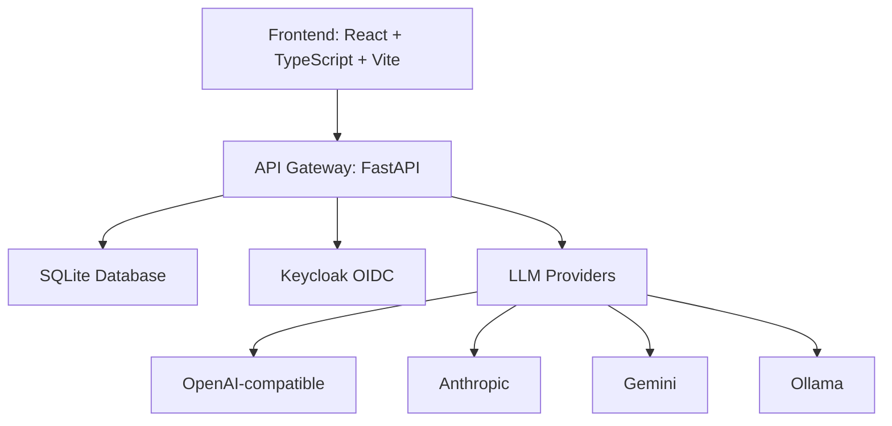

# vector-pilot-alan-vo

> Work in progress. This checkpoint may be incomplete or fail tests. See PLAN.md and STATUS.md before use.


**Alan Vo | AI & Machine Learning**

A developer tool for evaluating AI agent reasoning and model quality. Run reproducible evaluations, compare model performance, and track metrics over time.

## Problem

AI agents produce variable results on the same task. Developers need a systematic way to evaluate agent reasoning, measure model quality, and compare approaches with reproducible baselines.

## Solution

vector-pilot-alan-vo provides a complete evaluation framework:
- **Evaluation runs**: Define datasets, configure models, execute evaluations
- **Reproducible baselines**: Deterministic offline core works without any LLM key
- **Metrics tracking**: Cost, tokens, latency, accuracy, F1, custom metrics
- **Comparison dashboard**: Compare runs across models, providers, and configurations

## Architecture



## Features

- **Three core workflows**:
  1. Create evaluation with dataset and model configuration
  2. Execute evaluation runs with multiple models
  3. Compare results with metrics dashboard
- **AI/ML evaluation engine**: Agent reasoning evaluation with reproducible baselines
- **OIDC authentication**: Keycloak with SAML broker support
- **Multi-provider LLM support**: OpenAI-compatible, Anthropic, Gemini, Ollama
- **Role-based access**: Admin, Operator, Analyst roles
- **Full test coverage**: 21 backend tests, 8 frontend tests

## Quick Start

### Prerequisites

- Python 3.12+
- Node.js 24+
- Docker (for Keycloak)

### Local Development

```bash
# Backend
cd backend
python -m venv .venv
.venv/bin/pip install -r requirements.txt
.venv/bin/python -m pytest tests/
.venv/bin/uvicorn app.main:app --reload

# Frontend (in separate terminal)
cd frontend
npm install
npm run dev

# With Docker Compose (includes Keycloak)
docker compose up --build
```

### Keycloak Setup

1. Start Keycloak: `docker compose up keycloak`
2. Access admin console: http://localhost:8080 (admin/admin)
3. Realm "vector-pilot" is pre-configured with clients and users
4. Configure frontend with OIDC settings

## API Reference

### Evaluations

| Method | Endpoint | Description |
|--------|----------|-------------|
| POST | `/api/evaluations` | Create evaluation |
| GET | `/api/evaluations` | List evaluations (paginated) |
| GET | `/api/evaluations/{id}` | Get evaluation with runs |
| PATCH | `/api/evaluations/{id}` | Update evaluation |
| DELETE | `/api/evaluations/{id}` | Delete evaluation |

### Runs

| Method | Endpoint | Description |
|--------|----------|-------------|
| POST | `/api/evaluations/{id}/runs` | Create run |
| GET | `/api/evaluations/{id}/runs/{run_id}` | Get run with metrics |

### Health

| Method | Endpoint | Description |
|--------|----------|-------------|
| GET | `/api/health` | Health check |

## AI/ML Evaluation

The evaluation engine supports:
- **Deterministic offline core**: Run evaluations without LLM keys
- **Labeled datasets**: Small curated datasets for baseline measurement
- **Explicit metrics**: Accuracy, F1, precision, recall, custom metrics
- **Limitations discussion**: Documented in each evaluation run

Run a baseline evaluation:
```bash
cd backend
.venv/bin/python -c "
from app.services.evaluation import EvaluationService
from app.schemas.evaluation import EvaluationCreate, EvaluationRunCreate
# Example evaluation script
"
```

## Configuration

### Environment Variables

| Variable | Required | Description |
|----------|----------|-------------|
| `SECRET_KEY` | Yes | JWT signing key (32+ chars) |
| `DATABASE_URL` | No | SQLite default |
| `OIDC_ISSUER_URL` | Yes* | Keycloak realm URL |
| `OIDC_CLIENT_ID` | Yes* | OIDC client ID |
| `OIDC_CLIENT_SECRET` | Yes* | OIDC client secret |
| `LLM_PROVIDER` | No | openai, anthropic, gemini, ollama |
| `LLM_MODEL` | No | Model name |
| `LLM_BASE_URL` | No | Custom endpoint |
| `LLM_API_KEY` | No | Provider API key |

*Required for production authentication

### LLM Provider Adapters

Supported providers with httpx adapters:
- **OpenAI-compatible**: OpenAI, LiteLLM, OpenRouter, Ollama (OpenAI endpoint)
- **Anthropic**: Messages API
- **Gemini**: generateContent API
- **Ollama**: Native API

Keys only server-side. LLM explanations opt-in, labeled advisory, grounded in actual records.

## Security

- JWT validation with RS256, issuer/audience checks
- PKCE flow for SPA, tokens in sessionStorage only
- HttpOnly SameSite cookies for backend sessions
- CSRF protection on cookie-authenticated writes
- No hardcoded bypass in production
- Dev mode explicitly enabled, refuses in production

## Deployment

### Docker

```bash
docker compose up --build
```

### TLS Reverse Proxy

Required for production:
- Terminate TLS at reverse proxy (nginx, Traefik, Caddy)
- Forward to backend:8000, frontend:80
- Set `X-Forwarded-Proto` and `X-Forwarded-For` headers

### Backup/Restore

```bash
# Backup
docker compose exec backend cp /app/data/vector-pilot.db /backup/

# Restore
docker compose exec backend cp /backup/vector-pilot.db /app/data/
```

### Keycloak SAML Broker

Keycloak supports upstream SAML IdPs through identity brokering:
1. Configure SAML Identity Provider in Keycloak admin
2. Map SAML attributes to Keycloak roles
3. Update realm-export.json with IdP configuration

## Development

### Running Tests

```bash
# Backend
cd backend && PYTHONPATH=. .venv/bin/python -m pytest tests/ -v

# Frontend
cd frontend && npm test
```

### Project Structure

```
vector-pilot-alan-vo/
├── backend/
│   ├── app/
│   │   ├── api/v1/          # FastAPI routes
│   │   ├── core/            # Config, database
│   │   ├── models/          # SQLAlchemy models
│   │   ├── schemas/         # Pydantic schemas
│   │   └── services/        # Domain logic
│   ├── tests/               # Pytest tests
│   └── requirements.txt
├── frontend/
│   ├── src/
│   │   ├── api/             # Typed API client
│   │   ├── components/      # React components
│   │   ├── pages/           # Page components
│   │   └── test/            # Test setup
│   └── package.json
├── keycloak/
│   └── realm-export.json
├── compose.yaml
├── .github/workflows/ci.yml
└── README.md
```

## License

MIT © Alan Vo <alanvo@gmail.com>